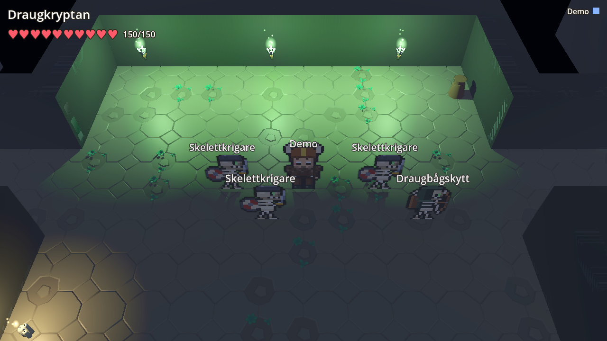

# Lilla Gården

Ett litet bondgårdsspel på svenska för hela familjen. Odla, ta hand om djur, snickra och bygg – tillsammans på samma gård från surfplatta och dator.

See [DESIGN.md](DESIGN.md) for the agreed design.

## What you can do

- Odla sju grödor, vattna, skörda, sälj i säljlådan eller laga mat på spisen.
- Hugg trä, knacka sten och snickra staket, stigar, väggar, kistor, möbler och djurhus.
- Skaffa höns, kaniner, får och kor (de behöver hus) samt hund och katt som följer med dig.
- Gå in i huset och möblera det. Lampor och spisen lyser på kvällen.
- Prata med Tant Greta och Fiskar-Sven – nya önskningar varje dag ger kr och stjärnor.
- Fiska i dammen med fiskespöet du får av Sven.
- Byt kläder i garderoben. Halloween, jul, påsk och midsommar följer kalendern.
- Allt tillsammans med upp till åtta spelare på samma gård. Inget dör, inget går sönder.
- Det du bygger är ditt: bara den som byggde något kan riva det (staket, väggar, kistor, möbler, djurhus…).
- 2D: chatta med alla som spelar (Enter/T eller 💬, färdiga ord för den som inte vill skriva).
- Röstprat (📞): prata med dem som sitter någon annanstans. De som är i samma rum (samma wifi) hör inte varandra
  genom spelet – en enhet i rummet är högtalare och pratar med de andra rummen. Rösten går direkt mellan
  enheterna och sparas aldrig; föräldrasidan väljer av / bara familjen / familj och gäster.
- 2D: säg åt hund, katt och häst att stanna (✋, X) och vissla så kommer de igen (🎵, V) – även från en annan karta.
- 2D: prata med alla bybor (Prata! i bybons fönster): frågor, berättelser, skämt, gåtor och sten, sax, påse med Elsa.
- 2D: väder som skiftar av sig självt – sol, moln, regn, åska, snö, hagel, blåst och dimma. Regnet vattnar åkrarna,
  snön gör marken vit och efter regn kan det bli regnbåge. Föräldrasidan kan välja väder.
- Utforska en oändlig värld med 15 sorters platser: skog, äng, berg med klippor, isvidder, strand, öken, träsk med
  spänger och irrbloss, djungel med tempel, vulkaner med lava, svampskog med älvringar, Dinodalen med fossil,
  Köpingar (marknadsstäder med kullersten, timmerhus och Diligensen), Rymdbasen – och långt borta Godislandet. Varje ny sorts plats ger en stjärna.
- Grottor överallt (kristallgrottor, isgrottor, sjörövargrottor, pyramider, tempel, lavagrottor…) med en skattkista
  för varje spelare varje vecka, ett hemligt rum bakom rasade stenar och kristaller och guld som växer tillbaka.
- Gräv upp skatter där det är ett kryss, dansa i älvringar, fånga dinosaurier och gelébjörnar med lasso, kläck ett
  drakägg – och åk raket till månen (månost, stjärnkristaller, rymdvarelser och ett kraschat ufo).
- Gör souvenirer av fynden: kristallampa, svamplampa och ett dinosaurieskelett. Nya kläder finns i skattkistorna.
- Sagan om Världsträdet: välj klass vid Kämpastenen (Väktare, Helare, Krigare eller Magiker) och lyssna på Völvan
  Sigrun, som berättar sagan i tio kapitel. Del I är Draugkryptan, Frostjättens borg och Surts smedja; del II, Lokes
  list, tar er vidare till Helheim, Svartalfheims gruvor, Havsormens tempel, Alvernas lund, Fenrisklyftan och
  Bifrost – nio fängelsehålor för hela familjen, med monster som slåss ihop, bossar vars stora attacker
  syns på marken innan de träffar (rader, drag mot bossen, läkning som man avbryter), vilostenar, runplattor som
  öppnar dörrar och skattkistor med egen skatt åt var och en. Bytet mellan bonde och hjälte (🧑‍🌾 → din klass) tar
  hjälten ut i världen: besvärjelser mot Lokes tjänare som vandrar i varje sorts plats, två jättemonster och
  uppgifter i varje kapitel. Skatterna har färger efter hur sällsynta de är, passar i tre platser (vapen, sköld,
  amulett) och ger kraft, hälsa och skydd; hjälten stiger i nivå 1–20. Husdjur, riddjur, dräkter och pynt till
  gården kan hittas. Ingen förlorar något när man faller.
- Köpingen öster om gården är en nordisk marknadsstad: kullerstensgator, timmerhus och långhus, lyktor, banérstänger,
  tunnor och en runsten på torget. Där åker du med hästkärror och ridhästar (köps under Kärror & hästar i
  gårdsbutiken – de följer med över kartkanten), Diligensen (5 kr, till ställen du redan besökt) och dvärgarnas
  Gruvtåg (15 kr, även till en okänd köping långt borta).
- Hjältenivåer 1–20 för alla, med eller utan klass: varje monster du besegrar ute i världen ger erfarenhet (svärd,
  båge, bazooka eller besvärjelser; vänner några rutor bort får lika mycket). Lätta vilda monster bor i varje
  sorts plats (Ängsvätte, Trollunge, Snötroll, Sandande, Djungelimp, Benödla, Sockerspöke och Rymdkryp). Varje nivå
  ger bara 1,5 % mer kraft och hälsa (med tak, så en vuxen aldrig blir mycket starkare än barnen), men belöningen
  är det man ser: glödande kappor och kronor som lyser i mörkret, Lyktfén, Ljushjorten, titlar, och sken omkring
  dig från nivå 10 och regnbågsskimmer på nivå 20.
- Större vildmark och landmärken: kartorna ute i världen är 96×96 rutor (gården, Köpingen, rymdbasen, grottorna och
  fängelsehålorna är kvar som förut). På varje karta gömmer sig två märkliga platser – Stencirkeln, Jätteeken, det
  frusna skeppet, Dvärgporten, Oasen, Apkungens tron, Eldbrunnen, Glasstornet med flera, 26 sorter – och den som rör
  vid en hittar den: en stjärna, kr, material till Smedjan och en berättelse. Dagbokens flik 🧭 Upptäckter listar dem,
  världskartan visar ❓ för en plats man har sett men inte rört och 🧭 för en man har hittat, och 5, 15 och 26 fynd
  ger prestationer.
- Smedjan: Smed-Stina i Köpingen smider varje vapen, sköld och amulett från +1 till +5 (kraft, skydd och hälsa) för
  material som blir ovanligare ju längre bort de finns: sten, guld och kristall nära gården, sällsynta fynd långt bort,
  monsteressens från fängelsehålornas monster och drakfjäll från de sista bossarna. Hon gör också en startuppsättning
  (Järnsvärd, Järnyxa, Ekstav, Jaktbåge, Träsköld, Stenamulett) åt den som inte har några skatter. Kraftgränsen är 2,0
  med smidet inräknat.
- Spela fängelsehålorna igen: bossens fulla skattkista kommer en gång per speldygn för var och en, därefter en
  ersättningskista med material (och drakfjäll från de sista bossarna), monstren släpper ibland monsteressens, och
  familjens bästa tid genom varje fängelsehåla sparas och visas i dagboken.

## Develop

```bash
pnpm install
pnpm db:up          # Postgres 17 in a container on port 5435
cp .env.example .env
pnpm dev            # server on :8080, the game on :5173, also on your LAN IP
```

Open `http://<your-computer-ip>:5173` on the tablet. Röstprat (voice) needs https, which browsers demand before they
hand out a microphone: `VITE_HTTPS=1 pnpm dev` serves the game over https with a self-signed certificate (accept the
warning once per device) and the server then wants `PUBLIC_URL=https://<your-computer-ip>:5173` in `.env`, so the
socket's origin check passes (or `ACCESS=open`). Two browsers on one computer land in the same room; use
"Jag sitter i ett annat rum" in the 📞 window to hear yourself. The parent page is at `/admin`
(log in with `PARENT_PASSWORD`; make join codes, manage devices, force a season, save, skip to the next day,
make it evening/morning).

Without `DATABASE_URL` the server runs in memory and saves nothing – handy for a quick look,
useless for a real farm.

## Production

```bash
pnpm build                     # server bundle + client PWA
DATABASE_URL=postgres://… node packages/server/dist/main.js   # serves the game (the LittleJS client) on :8080
```

Or use the container image built by GitHub Actions: `ghcr.io/tobiasbernting/lilla-garden:latest`.
It needs `DATABASE_URL` and listens on 8080. Migrations run on boot.
The public farm takes each new `:latest` the night after it's built (03:30 Swedish time): it dumps the database,
starts the new version and goes back to the old one, database included, if it doesn't answer on `/health`. So a
merge to `main` is live the next morning, and a migration must work on the real farm's data. The deploy lives in the
homelab repo (`cloud/roles/lilla-garden`).

(The 3D version, the Phaser client and the `gard-ljs` trial farm were retired on 2026-10-30; their last images
stay in the registry as they were. The minigames, Spelhallen and Rallyvärlden were removed on 2026-11-01, milestone
M1 of [PLAN.md](PLAN.md); the web game at `lilla-garden` keeps them.)

Environment:

| Variable          | Meaning                                                   |
| ----------------- | --------------------------------------------------------- |
| `DATABASE_URL`    | Postgres connection string (required for persistence)     |
| `PORT`            | HTTP/WebSocket port, default 8080                         |
| `SEASON_OVERRIDE` | `halloween`, `jul`, `pask`, `midsommar` or `none`         |
| `PARENT_PASSWORD` | Required (12+ characters): the parent login for `/admin`. The server refuses to start without it. |
| `ACCESS`          | `open` turns access control off entirely (old behaviour, home network only). Default: on. |
| `PUBLIC_URL`      | The public address, e.g. `https://gard.example.se`: used in invite links, makes cookies `Secure`, accepted as origin. |
| `ADMIN_PORT`      | Serve the parent page on its own port (and not on `PORT`). `ADMIN_HOST` sets its address (default `0.0.0.0`). |
| `NTFY_URL`        | ntfy topic URL for push notifications, e.g. `http://ntfy.example.lan/lilla-garden`. `NTFY_TOKEN` if the server needs one. |
| `TRUST_PROXY`     | `1` behind a tunnel or reverse proxy: take the visitor's IP from `CF-Connecting-IP`/`X-Forwarded-For`. Only set it when the server can't be reached directly. |
| `STUN_URLS`       | Röstprat: STUN servers, comma-separated. Default `stun:stun.cloudflare.com:3478`. Enough for most home networks. |
| `TURN_URLS`       | Röstprat: a TURN relay for the connections STUN can't manage (mobile data, strict NATs), with either `TURN_USERNAME` + `TURN_CREDENTIAL` (fixed login) or `TURN_SECRET` (coturn `use-auth-secret`: short-lived logins made by the server). |
| `CLOUDFLARE_TURN_KEY_ID` | Röstprat: Cloudflare's TURN service instead of a relay of your own (`CLOUDFLARE_TURN_API_TOKEN` alongside). Short-lived logins are fetched from its API and cached. The public farm has no open ports, so this is the one that fits it. |

## Native client

The game is being rewritten as a native Godot client (`packages/godot`, [PLAN.md](PLAN.md) section 3). Milestone M2
gave it login with a join code; **M3a** put the first dungeon on the screen: Draugkryptan as an HD-2D scene (a low-poly
3D crypt with the family's pixel characters and the saga's monsters standing in it as billboards), built from the same
data the browser draws, with your hero walking in it and everyone else interpolated. **M3b** makes it a fight: the
Krigare's four spells, the dungeon's telegraphs and bosses on screen, falling and getting up, chests with the loot
window, chat and emotes, a gamepad setting for the kids, a frame-time overlay and a bench, and a headless bot that
clears the first pack in CI. No farm and no world map yet. The browser game keeps working unchanged, and the two
clients can be in the same dungeon at the same time. `packages/godot/ART.md` has the art rules;
`packages/godot/assets/LICENSES.md` every asset's origin.



**Look at the dungeon without a server (demo mode):**

1. Install [Godot 4.7](https://godotengine.org/download) (the standard build, not .NET). Any 4.7.x works for
   editing; CI pins 4.7.2.
2. `godot --path packages/godot -- --demo` (or open `packages/godot/project.godot` in Godot, press Play, and the
   login screen comes up instead; the demo needs the command line). The recorded Draugkryptan of
   `packages/godot/assets/fixtures/draug.json` is drawn with its monsters, and you walk in it with WASD, the arrows
   or a gamepad's left stick; Escape or the start button opens the menu with the settings. Add `--at=24,53`
   to start in the first monster room, `--fight` to play a scripted fight with the mid-boss on the recording
   (telegraphs of every shape, the boss bar and cast bar, hit numbers, a wipe, a chest with the loot window; no
   server and no rules, only the pictures), and `--screenshot=/tmp/draug.png` to save a frame after 90 frames and quit.
3. `godot --path packages/godot -- --bench` runs that scripted fight for 10 s on each quality preset and prints the
   average frame time and the 1 % low per preset (the mean of the slowest 1 % of frames); F3 in the game shows the
   same numbers live. It needs a window: headless Godot renders nothing.

**Run it against a server:**

1. Start the server with the development way into the dungeon on: `DEV_TELEPORT=1 pnpm dev` (the native client has
   no world map yet, so it cannot walk to the arch; the switch lets the pause menu's "Gå in i Draugkryptan" ask the
   server to put you inside, as the arch would, making you a Krigare first if you have no class. Never set it on the
   real farm.) Make a join code on the parent page (`http://localhost:8080/admin`).
2. `godot --path packages/godot` (or press Play in the editor). On the login screen, type the server's address:
   `http://localhost:8080` for a local server (plain `http`/`ws` is only used for `localhost`; anything else becomes
   `https`/`wss`), or the real farm's address. Then the join code and what to call this computer, and press Kom in.
3. A code the parent approves shows the 6-digit number; the client polls `/api/gate` every few seconds and goes on
   to "Vem är du?" when the parent has approved the device. Pick a character (characters are still created in the
   browser for now).
4. You start on the farm, which the client does not draw yet: a notice says so. Press Escape, then "Gå in i
   Draugkryptan". The server generates the dungeon the normal way (`generateSaga`), sends it as `areaData`, and the
   crypt appears with you at its start.
5. **Fight.** `1`–`4` (gamepad `X`/`Y`/`B`/`RB`) are the Krigare's spells: Yxhugg, Stormsteg, Virvelvind,
   Bärsärkaraseri, on the bar at the bottom with their cooldowns; `5` (`LB`) drinks a potion. The server picks the
   monster (the nearest in reach, in sight for a ranged spell) unless you aim: click a monster, or Tab (d-pad right)
   cycles the monsters near you; Escape lets go. `E`, space or the south button use what is in front of you (the
   stairs, a chest, a rest stone, a plate; the prompt says what) and otherwise swing the axe. A boss marks its big
   attacks on the floor in red, filling up until they land: step out. Its cast bar at the top says when Sköldslag,
   Stormsteg or Isspjut can stop it (blue), and the spell's button lights up blue then. Numbers float up from hits,
   monsters flash and poof, the one chasing you carries a warning sign. Fallen heroes lie down (a box counts down to
   the rest stone; everyone fallen shows the pause and the walk back); chests open the loot window.
6. `Enter` or `T` (Back on the gamepad) opens the chat with the ready-made phrases; `V` (d-pad up) the emote wheel.
   Lines show as bubbles over heads and in the log in the corner.
7. Escape → Inställningar: Låg, Mellan, Hög (Mellan is the default; Låg is for a laptop with an Intel GPU);
   *Trollformler: Knappar / Hjul* (the four spells on the face buttons, or one button, `RB`/`Q`, that opens a wheel
   you lean the stick towards); *Visa bildfrekvens (F3)*.

**Two players, one in Godot and one in the browser.** Start the server with `DEV_TELEPORT=1`, log the Godot client
in as above and go in through the menu; in the browser, log in as another character and walk to Draugkryptan's arch
(or, with the same switch, nothing else is needed: the browser walks in the normal way). Both see each other's
spells, the same monster health and the same telegraphs, because all of it is the server's.

**Without a human (the bot).** `GODOT=~/godot/godot pnpm godot:bot` starts the server in memory (`ACCESS=open`,
`DEV_TELEPORT=1`, no Postgres), runs two headless clients in bot mode (`-- --bot`: log in, enter, walk to the first
pack, cast the four spells on cooldown, step out of telegraphs) and checks their reports against each other: casts
acknowledged, each other's casts seen, monsters beaten, the same monster health at the same server tick. The Godot
workflow runs it on every pull request.

The client stores the server address, its device token, the quality preset and the input settings in `user://settings.cfg`
(`~/.local/share/godot/app_userdata/Sagan om Världsträdet/` on Linux, `~/Library/Application Support/Godot/app_userdata/…`
on macOS, `%APPDATA%\Godot\app_userdata\…` on Windows); "Glöm den här enheten" clears the device. The token is the
same long random device token the browser keeps in its cookie, sent as `Authorization: Bearer` instead; the parent
page shows the device like any other and can pause or remove it, which closes the game socket at once (code 4003) and
sends the client back to the login screen. With `ACCESS=open` the server hands out no token and the client connects
without one.

**Generated files.** Every Swedish text comes from `packages/shared/src/sv.ts`; the client also reads object
footprints and solidity, the dungeons' colours and names, the creatures, the classes, the spells, the bosses' moves,
the saga's items and the chat phrases from the shared data, and the demo fixture from the shared dungeon generator. `pnpm godot:gen` writes all three (`assets/sv.json`, `assets/game.json`,
`assets/fixtures/draug.json`; each also has its own script, `godot:strings`, `godot:data`, `godot:fixture`). Commit
them; the Godot workflow fails when they are out of date. `pnpm godot:sprites` renders the pixel art in
`packages/client/src/art` to the sheets in `assets/sprites` with Playwright's Chromium (it needs one; the sheets are
committed, so CI does not run it), and `icons.png` with the spells' and emotes' emoji and the loot items' pictures.

**Art.** Free CC0 packs only (the owner's decision of 2026-11-01): KayKit Dungeon Remastered for the crypt's walls,
floor, torches, stairs, chests and candles, tinted to the palette in `ART.md`; what no reachable pack had (coffin,
bones, urn, rest stone, gate) is made in code. `packages/godot/tools/fetch-assets.sh` downloads the whole packs,
including the Kenney kits the build sandbox could not reach.

**Builds.** `.github/workflows/godot.yml` checks the generated files, imports the project, runs the login scene, the
Draugkryptan demo and the scripted fight headless for a moment (script errors fail there), runs the two bots against
a server in memory, and exports Windows x86_64, macOS universal,
Linux x86_64 and Linux arm64 with Godot 4.7.2 and its export templates (downloaded by pinned URL and SHA-512, cached
between runs). Every pull request runs it as a check (the exports are workflow artifacts), and a tag `v*` attaches the
four zips to a GitHub Release. The macOS app is ad-hoc signed and not notarized: the first start needs right-click →
Open.

## Who may enter (access control)

Lilla Gården is a kids' game, so nobody gets in without a parent having said yes:

1. **Nothing without an approved device.** Strangers only ever see a "private farm" page with a code field. The game
   itself, `/api` and the WebSocket all refuse browsers without an approved device cookie.
2. **Join codes.** On the parent page a parent makes a code (`ABCD-1234`) for a named person or family: guest or
   family, 1–5 devices, valid 1 hour–30 days. It's typed on the start page or opened as a link (`/join#CODE`; the
   fragment never reaches logs). Each device that joins is remembered (400 days); when the code has let in its
   devices or expires it stops working. Only a hash of the code is stored.
3. **The parent decides when making the code**: *let in directly* (the default; the parent gets a push) or *I approve
   each device* (the device waits with a 6-digit number until the parent approves it).
4. **Guests play only their own characters.** A guest device sees and plays only the characters it created (0–3 per
   device) or that the parent gave it; family devices play everyone. A parent signed in on the kids' tablet can also
   make it a family device directly (not when the parent page runs on its own port).
5. **Öppna igen**: a device that forgot the farm (cleared browser, new browser) gets a fresh one-time code from the
   device list and keeps its characters; the old key stops working.
6. **The parent stays in control**: close the farm for everyone, family only, or family + guests; play hours
   (Swedish time); pause or remove any device. Changes take effect at once: open connections are closed and the
   device lands on the gate page.
7. **Parent login**: password (`PARENT_PASSWORD`), optional two-step login with an authenticator app, rate limited
   (5 failures per address per 15 min, 30 per hour in total), 8-hour sessions. With `ADMIN_PORT` the parent page
   only exists on its own listener (bind it somewhere the internet can't reach, e.g. a Tailscale address); the public
   port answers 404 for `/admin`.
8. **Guessing codes**: 10 wrong codes per address per 15 min, and 100 wrong codes per hour from everywhere together,
   lock code entry for a while (and push a warning).
9. **Push notifications** (`NTFY_URL`): someone joined, someone waits for approval, a device was reopened, parent
   logins and failed logins, code entry locked.
10. **Log**: everything at the gate is logged on the parent page.
11. **Web hardening**: `HttpOnly` + `SameSite=Strict` cookies (`Secure` over HTTPS), origin checks on every form and
    on the WebSocket, strict Content-Security-Policy, no framing, `noindex`, `/health` reveals nothing.

A native client (the Godot game) cannot hold the cookie, so the same device token is also accepted as an
`Authorization: Bearer` header on `/api/*` and on the game socket; `POST /api/join` answers it in JSON. The parent page
stays cookie-only. See "Native login" in [DESIGN.md](DESIGN.md).

There is still no text chat: players can only use emotes.

## Layout

- `packages/shared` – game data, world simulation, Swedish strings (no I/O). The saga lives in
  `saga.ts` (data, forge tables) and `sagasim.ts` (rules), the wild maps' landmarks in `landmarks.ts` (the table) and
  `explore.ts` (discovery, seen, old saves). Vitest covers the sim.
- `packages/server` – WebSocket game server (20 Hz), Postgres via Drizzle, `/api/players`, `/admin`, `/health`
- `packages/clientljs` – the game, drawn with [LittleJS](https://github.com/KilledByAPixel/LittleJS): light and
  shadow, animation and the cozy extras (see below). PWA, landscape. Its HUD, menus, networking, sounds and pixel art
  come from `packages/client` (the `@v1/*` alias); the view is its own.
- `packages/godot` – the native client (Godot 4.7, GDScript): the login screen, the socket, Draugkryptan on screen and
  the Krigare fighting in it; `tools/` makes its generated files from the shared package
- `packages/client` – the HTML menus, HUD, networking, client state, sounds and the pixel art generated in code
  (once the Phaser client; that view is gone, the shared parts stay here)

## Controls

- Dator: WASD/piltangenter, `E`/mellanslag för att använda, klick på en ruta, `1–8` väljer verktyg, `Q` ryggsäck, `F` emotes (🐴 Gnägg! är hästens läte), `H` hjälp, `Enter`/`T` chatt, `X` husdjuren stannar, `V` vissla, `Esc` stänger.
- Surfplatta: styrspak till vänster, stor handknapp till höger, tryck på en ruta bredvid dig.
- Fängelsehålorna (Sagan om Världsträdet): klicka eller tryck på ett monster för att sikta och slå på det; `E`/mellanslag
  och ✋ slår på det närmaste monstret inom räckhåll; `1`–`4` är klassens besvärjelser, `5` läkedryck, Tab (🎯 på
  surfplatta) byter monster. En nedtryckt knapp slår direkt, hålls den kvar visas vad besvärjelsen gör.
- Hjälteläget (Sagan om Världsträdet, när du har valt klass): hjälteknappen (🧑‍🌾, och din klass när den är på) byter
  mellan bonde och hjälte ute i världen. Som hjälte gäller samma knappar som i en fängelsehåla utomhus: `1`–`4`
  besvärjelser, `5` läkedryck, Tab/🎯 byter monster, och `E`/mellanslag slår med klassens vapen på monster inom
  räckhåll. `G` (⚔️) öppnar utrustningsfönstret, där du tar på vapen, sköld och amulett från ryggsäcken, och `J`
  dagboken med sagans kapitel. På handkontrollen öppnar Select utrustningen utomhus.
- Handkontroll (Xbox, PlayStation, Switch): vänster spak går, `A`/`X`/`RT` använder, `B`/`LT` springer, `LB`/`RB` eller
  styrkorset vänster/höger väljer verktyg, `Y` ryggsäck, styrkorset upp emotes och ner minikarta, Start hjälp, Select bok.
  I en fängelsehåla är `X`/`Y`/`B`/`RB` besvärjelserna, `LB` läkedryck, styrkorset vänster/höger byter monster och
  Select ryggsäck. I menyerna flyttar spaken/styrkorset markeringen, `A` trycker och `B` stänger.
  Hur du kopplar ihop en Xbox-, PS5- eller Switch-kontroll med en Android-surfplatta, Mac eller PC står i hjälpen under 🕹️ Handkontroll.
- `?` i hörnet öppnar hjälpen (visas automatiskt första gången på en enhet).

## Art

All pixel art (terrain, objects, crops, animals, characters, icons) is generated in code at boot
(`packages/client/src/art`). The design originally planned to use Kenney's CC0 roguelike tiles for
terrain and objects; swapping those in later only touches `art/world.ts`.

### Grafiken (LittleJS)

The game is drawn by LittleJS at screen resolution (the earlier Phaser client used a 320×180 canvas), so things
can lean and squash smoothly. There is one art style, the shaded pixel art. It needs WebGL 2
(and says so on a screen without it).

- Ljus: the light map follows the day (golden morning, white noon, orange sunset, blue night, purple at Halloween),
  greyer under clouds and darker in storms. At night lamps, torches, stoves and lit windows shine, every player
  carries a lantern, carts and coaches carry lanterns, and lightning flashes the whole map.
- Skuggor: trees, houses, people and animals cast sun shadows that lean long to the west in the morning, sit behind
  things at noon and lean east in the evening.
- Rörelse: trees, grass, flowers and crops sway with the wind and rustle when walked through; people bob as they
  step, squash when they use something, swing their tool and squeeze through the middle when they turn; animals
  hop; new things pop up, removed things shrink away, crops pop when they grow and picked-up things fly to whoever
  took them.
- Väder: rain with ripples, snow, hail, leaves and gusts in the wind, fog banks, cloud shadows drifting over the
  fields and a rainbow after rain. Fireflies on summer nights.
- Årstider: autumn colours, leaves falling and lying under the trees (by the real calendar), snow on the branches
  when the ground is white, blossom in spring.
- Mys: light falls out of lit windows onto the ground at night, smoke rises from chimneys, the farmhouse gets
  sunbeams with dust (moonbeams at night) and a closer camera, butterflies and sparrows, lily pads and jumping fish,
  the moon and stars in the pond, dawn mist and dew, puddles on the paths when it rains, a soft evening glow, a
  tilt-shift "model village" blur, and quiet sounds: crickets, an owl, birdsong at dawn, crackling fires, rain on the
  roof indoors.
- Each extra can be switched off from the address bar for comparing: `?fx=none`, or a list like `?fx=seasons,smoke`
  (`seasons`, `windows`, `smoke`, `indoors`, `critters`, `pond`, `mist`, `puddles`, `glow`, `tiltshift`, `sounds`);
  `?year=winter` previews another season. On a slow screen (under 45 fps after a few seconds) the glow and
  tilt-shift, the one costly pass, turn themselves off; `?quality=high` keeps them.
